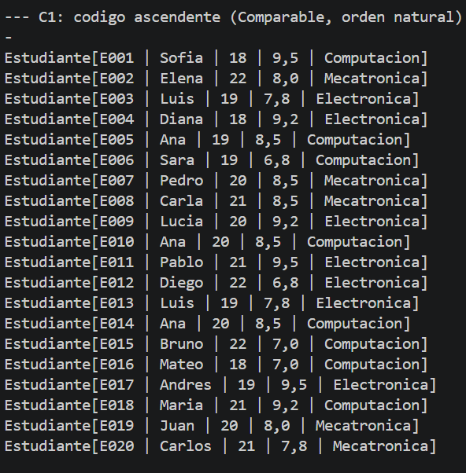
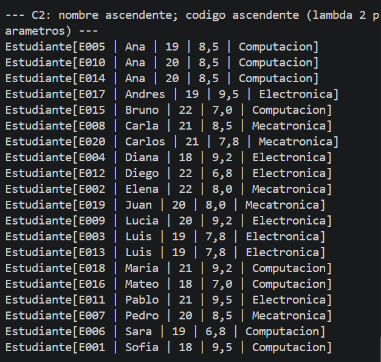
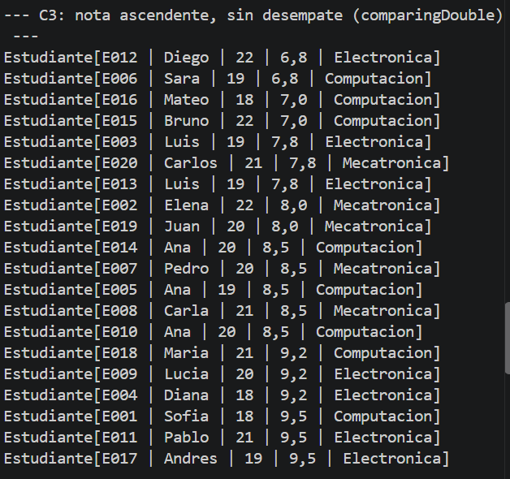

# PL1 Ordenamiento de estudiantes con Comparator y Comparable

**Autor:** Evelyn Mayancela

**Asignatura:** Estructura de Datos

## Objetivo
Ordenar 20 estudiantes con diferentes criterios usando Comparable (orden natural por codigo) y Comparator (lambdas y referencias a metodos), siempre sobre una copia de la lista original.

## Analisis
**Signo de compareTo():** negativo = el actual va antes, cero = empate, positivo = va despues. En Estudiante el orden natural es el codigo.

**reversed() en un comparador compuesto:** invierte todo el comparador, desempates incluidos. En C4 se invierte solo la nota y el nombre se agrega despues con thenComparing. En C5 el nombre descendente usa Comparator.reverseOrder() solo en ese criterio.

**Nota igual, codigo distinto:** en C3 el comparador solo mira la nota y devuelve 0 aunque los codigos difieran. sort es estable, asi que se conserva el orden de entrada (nota 8.5: E014, E007, E005, E008, E010).

**C7:** la nota ajustada se calcula con una funcion aparte; la nota del objeto no cambia.

**Casos propios:**
1. E100 (Computacion, 9.9): comprueba el tope de 10.0 en la nota ajustada y que la original sigue en 9.9.
2. Dos "Ana" (E900 y E200): comprueba que C2 desempata por codigo.

## Resultados

## Conclusiones
1. Comparable vs Comparator, citando C1 y otra consulta.
2. desempates, citando C4 o C6 con codigos de tu salida.
3. estabilidad, citando C3 y la nota 8.5.
